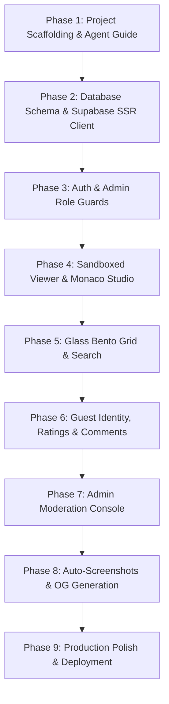

# Master Plan: Vibe UI Show

**Project Name:** Vibe UI Show  
**Workspace Location:** `C:\Users\Computer\Documents\Dev\vibe-ui`  
**Platform:** Next.js 16 (App Router) + Supabase + Tailwind CSS v4 + Vercel  
**Status:** Architecture & Master Plan Finalized

---

## 1. Executive Summary & Product Vision

**Vibe UI Show** is an open, curated showcase platform for "vibe coders", creative frontend engineers, and generative UI designers to publish, discover, inspect, rate, and comment on interactive HTML/CSS/JS experiments.

Unlike static CodePens or generic screenshot galleries:
1. **Interactive First:** Every submission runs in a secure, sandboxed live viewer capable of rendering 3D graphics (Three.js, WebGL), canvas animations (p5.js), and modern styling (Tailwind Play CDN).
2. **Glassmorphic Bento Discovery:** A dark glass aesthetic (`backdrop-blur`, subtle borders, glowing accents) arranged in an organic bento grid where the top-rated project occupies a hero focal tile, flanked by trending and new experiments.
3. **Low-Friction Community Interaction (Hybrid Identity):** Anyone can star ⭐, bookmark 🔖, and comment immediately without high sign-up barriers, protected by an HMAC-signed cryptographic guest token system, with full upgrade-to-account persistence.
4. **Creator & Admin Empowerment:** Creators get a split-pane Monaco Editor workspace with real-time preview; administrators get an intuitive moderation and curation suite to approve, reject, flag, feature, and manage projects.

---

## 2. Research & Library Stack (Version Verified)

| Concern | Package / Technology | Version | Justification & Architecture Notes |
| :--- | :--- | :--- | :--- |
| **Framework** | `next` | `16.4.2` | App Router, React Server Components (RSC), typed route handlers, edge runtime support |
| **Core UI** | `react` & `react-dom` | `19.3.0` | Modern React compiler-ready, actions, optimized transitions |
| **Styling** | `tailwindcss` | `4.3.3` | Tailwind v4 CSS-first config, glass tokens, dark mode primitives, container queries |
| **Primitives** | Radix UI / `shadcn/ui` style | Latest / v4 compatible | `class-variance-authority` (0.7.1), `clsx` (2.1.1), `tailwind-merge` (3.7.0) |
| **Animation** | `motion` | `14.5.0` | Bento grid micro-interactions, layout morphing, modal transitions |
| **Database & Auth** | `@supabase/ssr` + `@supabase/supabase-js` | `0.12.7` / `2.118.0` | Postgres, Row-Level Security (RLS), triggers, GitHub OAuth + magic link |
| **Code Editor** | `@monaco-editor/react` | `4.7.0` | Full VS Code editing experience with syntax highlighting, auto-close tags, formatting |
| **Forms & Validation** | `react-hook-form` + `zod` + `@hookform/resolvers` | `7.90.0` / `4.6.7` / `3.10.0` | Type-safe form schemas for upload, moderation, profile management |
| **Notifications** | `sonner` | `2.0.8` | Glass-styled toast notifications |
| **Icons** | `lucide-react` | `1.61.0` | Feather-style icons matching the glass/bento aesthetic |
| **HTML Sandbox** | Sandboxed `<iframe srcdoc>` | Native | Strict `sandbox="allow-scripts allow-pointer-lock"` (no `allow-same-origin`) |
| **Screenshot Pipeline** | `playwright-core` + `@sparticuz/chromium` | `1.64.1` / `153.0.0` | Headless rendering cron worker for cover cards and social OG sharing |
| **Deployment** | Vercel | Production Edge | Zero-config Next.js deployment, Cron jobs, Edge middleware, Supabase integration |

---

## 3. System Architecture & Routing Map

```mermaid
graph TD
    Client["Browser Client (Dark Glass Theme)"]
    NextServer["Next.js App Router (RSC & Server Actions)"]
    SupaDB[("Supabase Postgres (RLS & Triggers)")]
    SupaStorage["Supabase Storage (Project Covers)"]
    SandboxIframe["Sandboxed Iframe (<base> + ESM Shim)"]
    CronWorker["Vercel Cron Screenshot Worker"]

    Client -->|View / Browse / Filter| NextServer
    NextServer -->|Fetch published & metadata| SupaDB
    Client -->|Run Code / Three.js| SandboxIframe
    SandboxIframe -.->|Fetch CDN modules (esm.sh / jsDelivr)| CDN["Public CDNs"]
    Client -->|Upload / Rate / Comment| NextServer
    NextServer -->|Verify HMAC & Enforce RLS| SupaDB
    CronWorker -->|Fetch Pending Queue| SupaDB
    CronWorker -->|Render Headless & Upload Cover| SupaStorage
```

### Application Routes

- **`/` (Explore / Homepage):**
  - Sticky glass header with search bar (instant debounced FTS search), filter chips (Top Rated ⭐, Most Starred 🔖, Trending 🔥, Newest ⚡), and category tags (`Three.js`, `Canvas`, `CSS Art`, `WebGL`, `UI Components`).
  - Hero bento tile: The #1 ranked project rendered with live interactive preview or dynamic snapshot card.
  - Bento sub-tiles: 2x2 and 1x1 glass cards showing live ratings, star count, author badge, and visual tags.
- **`/p/[id]` (Project Detail & Live Player):**
  - Full-screen split or tabbed view (`Preview`, `Code`, `Comments & Feedback`).
  - Real-time rating widget (1 to 5 stars with fractional averages).
  - Star/bookmark button with instant optimistic feedback.
  - Plain-text threaded comment discussions with guest author handles.
  - "Open in Sandbox Fullscreen" (`/embed/[id]`).
- **`/upload` (Creation Studio):**
  - Dual-pane layout: Monaco editor on the left with instant live reload preview on the right.
  - Template selector: Blank HTML, Three.js 3D Cube starter, Canvas Particle starter, Tailwind Play starter.
  - Project metadata form: Title, description, tags array, custom cover upload or auto-snapshot option.
- **`/admin` (Moderation & Curation Console):**
  - Role-protected route (enforced via Supabase session + database trigger role validation).
  - Project queue: pending, published, flagged, rejected.
  - Quick action bar: "Feature Project", "Approve", "Flag Abuse", "Takedown Code", "Delete Comment".
  - Audit log and guest rate-limit status.
- **`/u/[username]` (User Portfolio):**
  - User's published vibe projects, total stars received, average ratings, and bookmarked projects.
- **`/login` (Authentication Modal / Page):**
  - GitHub OAuth and Magic Link email authentication.
  - Guest claim flow (link guest-created comments and ratings to new account).
- **`/embed/[id]` (Isolated Fullscreen Viewer):**
  - Pure CSP-hardened iframe host page for embedding in external sites or full-screen view.

---

## 4. Sandboxed HTML Viewer & Three.js/CDN Integration

### Security Boundary: Zero Same-Origin Access
Arbitrary user-uploaded HTML and JavaScript must be executed in a zero-trust environment.
```html
<iframe
  srcdoc="{injectedPayload}"
  sandbox="allow-scripts allow-pointer-lock"
  csp="default-src 'self' 'unsafe-inline' 'unsafe-eval' https://* data: blob:;"
  loading="lazy"
  title="Vibe Sandbox"
/>
```
- **Crucial Rule:** Omit `allow-same-origin`. This guarantees that user scripts can **never**:
  - Read or write `localStorage`, `sessionStorage`, or cookies.
  - Access parent window properties or hijack the Supabase auth token.
  - Perform CSRF requests masquerading as the user.
- **Form and Navigation Restrictions:** Without `allow-forms` or `allow-top-navigation`, malicious user code cannot submit phishing forms or redirect the user away from Vibe UI.

### Injected Helper Shim
To make Three.js, p5.js, Tailwind, and React experiments work seamlessly without requiring a heavy bundler, the viewer injects a lightweight preload preamble:
```html
<!DOCTYPE html>
<html>
<head>
  <meta charset="utf-8">
  <meta name="viewport" content="width=device-width, initial-scale=1">
  <base target="_blank">
  <!-- Import Map for Modern ES Modules -->
  <script type="importmap">
  {
    "imports": {
      "three": "https://esm.sh/three@0.170.0",
      "three/addons/": "https://esm.sh/three@0.170.0/examples/jsm/",
      "three/examples/jsm/": "https://esm.sh/three@0.170.0/examples/jsm/",
      "gsap": "https://esm.sh/gsap@3.12.5",
      "lucide": "https://esm.sh/lucide@0.460.0"
    }
  }
  </script>
  <!-- Tailwind CSS Play CDN for instantaneous styling experiments -->
  <script src="https://cdn.tailwindcss.com"></script>
  <style>
    /* Reset & dark-friendly default canvas */
    html, body {
      margin: 0;
      padding: 0;
      width: 100%;
      height: 100%;
      overflow: hidden;
      background-color: #090a0f;
      color: #f1f5f9;
      font-family: ui-sans-serif, system-ui, sans-serif;
    }
  </style>
</head>
<body>
  {USER_HTML_CODE}
</body>
</html>
```

---

## 5. Hybrid Identity & Anti-Abuse Design

### Problem
Forcing authentication before letting users vote, star, or comment kills community virality. However, anonymous guest interactions invite bot spam and ballot stuffing.

### Solution: HMAC-Signed Guest Session
1. **Cryptographic Cookie (`vibe_guest_session`):**
   - Issued by a Next.js Route Handler or Middleware.
   - Value: `guest_<uuid>.<timestamp>.<signature>` signed with server-side `GUEST_SECRET`.
   - Cannot be forged by tampering with headers.
2. **Server Action Enforcement:**
   - Every rating, star, or comment submitted by an unauthenticated visitor checks the guest token signature.
   - If valid, the database records the action linked to `guest_id`.
3. **Database Constraints:**
   - Ratings table features unique composite indexes:
     - `UNIQUE(project_id, user_id)`
     - `UNIQUE(project_id, guest_id)`
   - Upsert semantics allow guests and users to change their score (1 to 5) without inflating total vote counts.
4. **Anti-Abuse Safeguards:**
   - Server Actions hash incoming client IP via SHA-256 with a salt; store only `ip_hash` for rate-limiting (e.g. max 5 comments / 5 min).
   - Plain text comment sanitization (zero HTML/Markdown script tags accepted).
5. **Account Upgrades:**
   - When a guest subsequently registers via GitHub or Magic Link, an onboarding action links existing `guest_id` rows to their new `user_id`.

---

## 6. Database Schema & RLS Policies (Supabase Postgres)

```mermaid
erDiagram
    PROFILES ||--o{ PROJECTS : creates
    PROFILES ||--o{ RATINGS : votes
    PROFILES ||--o{ FAVORITES : bookmarks
    PROFILES ||--o{ COMMENTS : posts

    PROJECTS ||--o{ RATINGS : receives
    PROJECTS ||--o{ FAVORITES : collects
    PROJECTS ||--o{ COMMENTS : contains
    PROJECTS ||--o{ SCREENSHOT_QUEUE : triggers

    PROFILES {
        uuid id PK
        text username
        text avatar_url
        text role "user | admin"
        timestamptz created_at
    }

    PROJECTS {
        uuid id PK
        uuid user_id FK
        text title
        text description
        text array tags
        text html_code
        text cover_url
        text status "published | pending | rejected | flagged"
        boolean is_featured
        int view_count
        numeric avg_rating
        int rating_count
        int favorite_count
        tsvector search_vector
        timestamptz created_at
    }

    RATINGS {
        uuid id PK
        uuid project_id FK
        uuid user_id FK
        text guest_id
        smallint rating "1 to 5"
        timestamptz created_at
    }

    FAVORITES {
        uuid id PK
        uuid project_id FK
        uuid user_id FK
        text guest_id
        timestamptz created_at
    }

    COMMENTS {
        uuid id PK
        uuid project_id FK
        uuid user_id FK
        text guest_id
        text guest_name
        text content
        boolean is_hidden
        timestamptz created_at
    }

    SCREENSHOT_QUEUE {
        uuid id PK
        uuid project_id FK
        text status "pending | processing | completed | failed"
        int attempts
        timestamptz created_at
    }
```

### Key Triggers & Procedures
1. **Average Rating Calculator:**
   - Automatically recomputes `avg_rating` and `rating_count` on `RATINGS` `INSERT`, `UPDATE`, or `DELETE`.
2. **Full-Text Search (FTS) & Trigram Indexing:**
   - Generates `search_vector` from `title || ' ' || coalesce(description, '') || ' ' || array_to_string(tags, ' ')`.
   - GIN index enabled for sub-millisecond instant search across thousands of vibe projects.
3. **Admin Role Immutability:**
   - Security definer trigger preventing normal authenticated users from modifying their own `role` column in `profiles`.

---

## 7. Auto-Screenshot & Cover Generation System

1. **Instant Feedback:** On upload, projects default to a deterministic, vibrant CSS radial/mesh gradient cover card containing the title and tags. The project goes live without blocking on headless browser tasks.
2. **Queue Ingestion:** New project uploads insert a job into `SCREENSHOT_QUEUE`.
3. **Headless Cron Worker:**
   - Scheduled via Vercel Cron (`/api/cron/screenshots`).
   - Uses `playwright-core` and `@sparticuz/chromium`.
   - Spins up browser instance, sets viewport to `1200x750`, injects HTML, waits for canvas/WebGL draw event (or 2.5s network idle), takes screenshot buffer.
   - Uploads to Supabase Storage (`project-covers` bucket) and updates `projects.cover_url`.
   - On error, marks status as `failed` and preserves the gradient placeholder card.

---

## 8. Step-by-Step Implementation Roadmap



### Phase Breakdown
1. **Phase 1: Project Scaffolding & Agent Guide**
   - Next.js 16.4.2 App Router with TypeScript and Tailwind CSS v4.
   - Pin core packages and write `agent.md` & `MASTER_PLAN.md`.
   - Setup glassmorphism CSS design tokens (`globals.css`).
2. **Phase 2: Database Schema & Migrations**
   - Write Supabase SQL migration files (`schema.sql`, `triggers.sql`, `rls.sql`).
   - Configure `@supabase/ssr` server and browser client singletons.
   - Write type-safe database definition types (`src/types/database.ts`).
3. **Phase 3: Auth, Profiles & Role Protection**
   - Implement Supabase Auth (GitHub OAuth + Magic Link).
   - Create profile sync trigger and protected route middlewares.
   - Enforce server-side role validation for `/admin`.
4. **Phase 4: Sandboxed HTML Viewer & Monaco Upload Studio**
   - Build sandboxed `<iframe srcdoc>` component with ESM Three.js & Tailwind support.
   - Build `/upload` split-screen interface with Monaco Editor and live preview.
   - Add template presets (Three.js 3D cube, Canvas particles, Glass UI card).
5. **Phase 5: Glass Bento Grid Homepage & Search**
   - Build Bento grid layout component (Hero #1 spot, 2x2 featured, 1x1 cards).
   - Implement Postgres FTS search bar with tag filters and sorting (Top Rated, Newest, Stars).
   - Glassmorphic card styling with Motion hover effects.
6. **Phase 6: Hybrid Ratings, Stars & Threaded Comments**
   - Implement HMAC guest cookie utility.
   - Build 1-to-5 star rating component with optimistic UI updates.
   - Threaded comment system with plain text rendering and guest handles.
7. **Phase 7: Admin Moderation Panel**
   - Review dashboard for submitted projects (approve/reject/feature).
   - Moderation actions for flagging abuse or removing offensive comments.
   - Overview metrics (total submissions, view counts, active users).
8. **Phase 8: Screenshots & Media**
   - Playwright headless screenshot queue worker.
   - Dynamic SVG / Canvas fallback cover generation.
   - OpenGraph metadata generation for social sharing (`next/og`).
9. **Phase 9: Production Deployment & Verification**
   - Set up Vercel project with environment variables.
   - Run production build and verify CSP headers and sandbox isolation.
